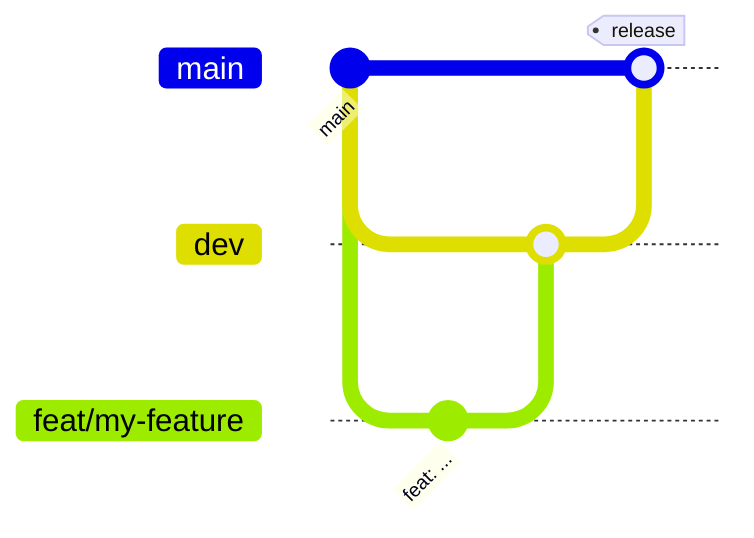

# Git Workflow

| Branch | Role |
| ------ | ---- |
| `main` | Production. A push triggers [[Release Process]] (and an image if a release is warranted). |
| `dev` | Integration branch. |
| `feat/*`, `fix/*` | Work branches (for example `feat/init`, `feat/test`, `feat/apiClient`). Merged by pull request. |

## Rules

- Open pull requests towards `dev` (then `dev` towards `main`).
- PRs to `main` and `dev` run the test workflow, SonarCloud and CodeRabbit ([[CI-CD Pipelines]], [[Code Quality Services]]).
- Write commit messages following [[Commit Convention]]: they drive versioning.
- Do not edit `CHANGELOG.md` by hand.
