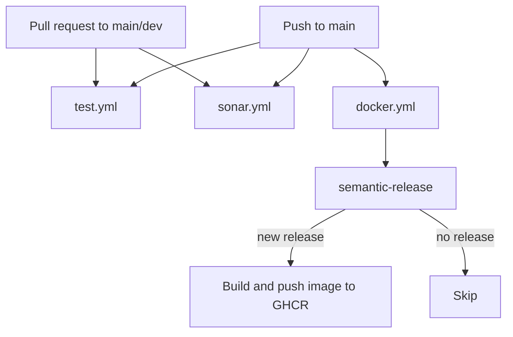

# CI/CD Pipelines

Three GitHub Actions workflows in `.github/workflows/`.

## `test.yml` (Test)

- **When:** PR to `main`/`dev`; push to `main`/`dev` (ignoring `**.md`).
- **Concurrency:** a new commit cancels the previous run on the same ref. Timeout 15 min.
- **Steps (Node 22):**
  1. `npm ci` with the Cypress binary cached
  2. `npm run lint`
  3. `npm run type-check`
  4. Component tests (Cypress GitHub Action)
  5. `npm run build`
  6. E2E Gherkin tests against `npm run preview` (waits on port 4173, 60 s)
  7. Uploads `cucumber-reports` (always) and `cypress-screenshots` (on failure)

## `sonar.yml` (Build)

SonarQube scan on push to `main`/`dev` and on PRs. Needs the `SONAR_TOKEN` secret. See [[Code Quality Services]].

## `docker.yml` (Build & Push Docker Image)

- **Auto:** push to `main` (ignoring `**.md`): runs semantic-release, then builds and pushes only if a release was published.
- **Manual:** `workflow_dispatch` skips versioning and tags the image with the branch name (`/` replaced by `-`).
- **Tags:**

| Case | Tags |
| ---- | ---- |
| Stable release `1.2.3` | `1.2.3` and `latest` |
| Prerelease `1.1.0-init.1` | `1.1.0-init.1` only |
| Manual run on `feat/x` | `feat-x` |

- Registry: `ghcr.io/<owner>/<repo>` (lowercase). Build arg `VITE_API_URL` comes from the repository variable of the same name, see [[Environment Variables]].
- Permissions: contents, issues, pull-requests (write) for semantic-release; packages (write) for GHCR.

Related: [[Release Process]] · [[Docker]]
