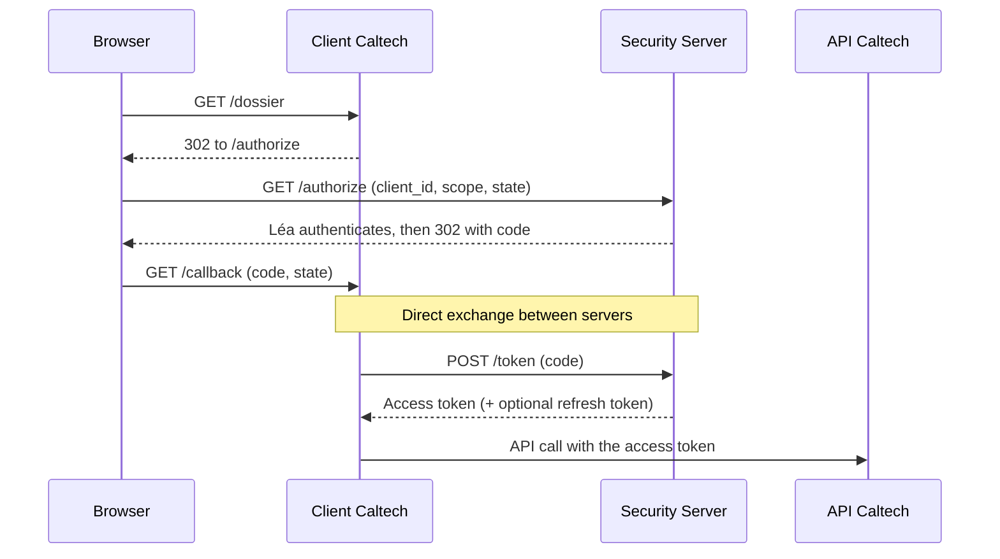

Historical reference flow. It lets Caltech obtain an access token for the API.

> [!warning] Limitation
> Nothing in the code exchange proves it is presented by the client that requested it → [[02-pkce/why-pkce|Why PKCE]].

---

%% footer %%

> [!info] Related
> **Key terms:** [[reference/glossary#PKCE|PKCE]]
>
> **See also:** [[02-pkce/pkce-flow|Flow with PKCE]] · [[03-openid-connect/oidc-flow|OIDC Flow]] · [[reference/oauth-flows|OAuth Flows and Uses]]

← [[01-oauth2/authorization-code|The Authorization Code]] · [[01-oauth2/index|↑ OAuth 2.0]] · [[02-pkce/index|PKCE]] →
