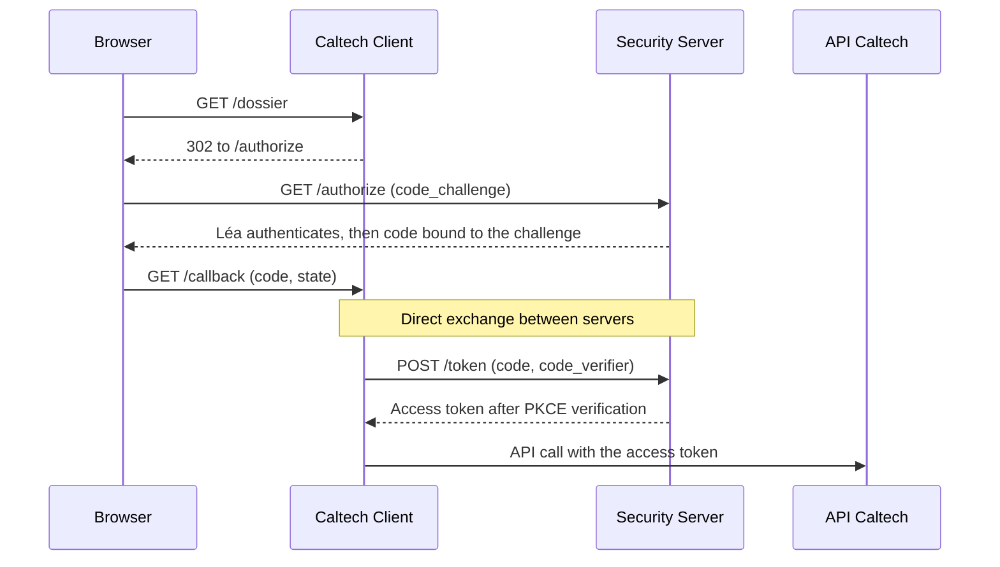

The initial request carries the hash. The client presents the original value during the exchange.

Compare with [[01-oauth2/authorization-code-flow|Authorization Code Flow]].

---

%% footer %%

> [!info] Related
> **Key terms:** [[reference/glossary#Authorization code|Authorization code]]
>
> **See also:** [[01-oauth2/authorization-code-flow|Authorization Code Flow]] · [[03-openid-connect/oidc-flow|OIDC Flow]] · [[reference/oauth-flows|OAuth Flows and Uses]]

← [[02-pkce/principle|PKCE Principle]] · [[02-pkce/index|↑ PKCE]] · [[02-pkce/one-proof-two-requests|One Proof, Two Requests]] →
