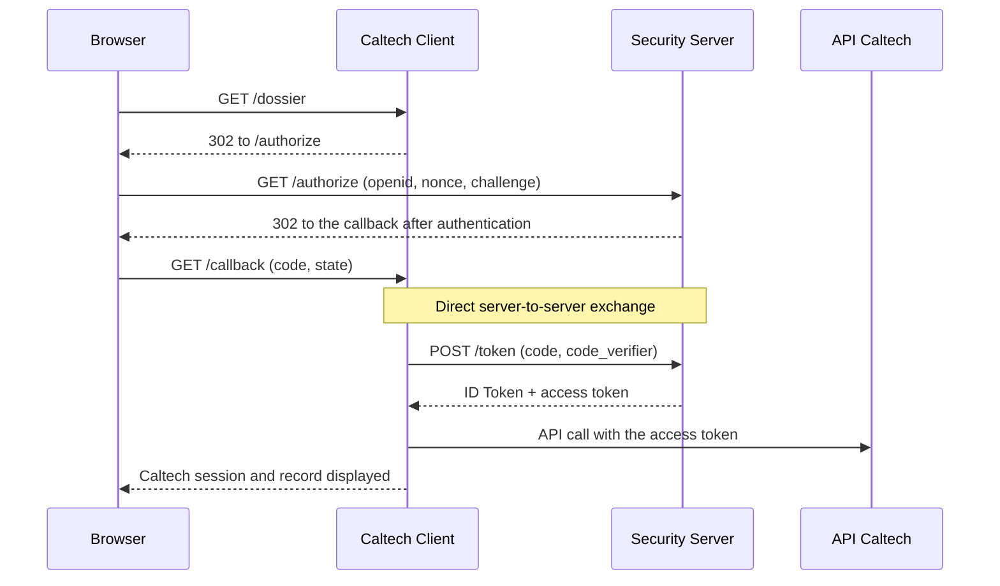

OAuth 2.0 and PKCE stay in place. The client receives the proof of identity when it exchanges the code.

---

%% footer %%

> [!info] Related
> **Key terms:** [[reference/glossary#PKCE|PKCE]]
>
> **See also:** [[01-oauth2/authorization-code-flow|Authorization Code Flow]] · [[02-pkce/pkce-flow|Flow with PKCE]] · [[reference/oauth-flows|OAuth Flows and Uses]] · [[03-openid-connect/messages|OIDC Messages]] · [[04-federation/two-oidc-transactions|Two OIDC Transactions]]

← [[03-openid-connect/why-oidc|Why OIDC]] · [[03-openid-connect/index|↑ OpenID Connect]] · [[03-openid-connect/messages|OIDC Messages]] →
