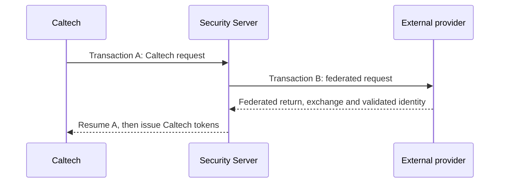

Transaction **A** for Caltech. Transaction **B** with the external identity provider.

> [!note]
> The redirects of each transaction go through the browser. Each flow has its own parameters (`state`, `nonce`, PKCE…).

---

%% footer %%

> [!info] Related
> **Key terms:** [[reference/glossary#PKCE|PKCE]] · [[reference/glossary#nonce|nonce]] · [[reference/glossary#state|state]]
>
> **See also:** [[03-openid-connect/oidc-flow|OIDC Flow]]

← [[04-federation/why-federation|Why Federation]] · [[04-federation/index|↑ Identity Federation]] · [[04-federation/federation-and-rights|Federation Identifies, Caltech Decides]] →
