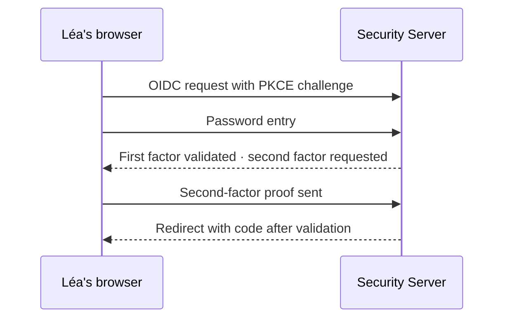

The check takes place on the Security Server during authentication.

> [!note]
> The browser returns to Caltech. The exchange at `/token` follows the flow already covered ([[02-pkce/pkce-flow|Flow with PKCE]]).

---

%% footer %%

> [!info] Related
> **Key terms:** [[reference/glossary#PKCE|PKCE]]
>
> **See also:** [[06-passkeys-webauthn/passkeys-and-mfa|Passkeys and MFA]]

← [[05-mfa/factors|The Factors]] · [[05-mfa/index|↑ MFA]] · [[05-mfa/totp|TOTP]] →
