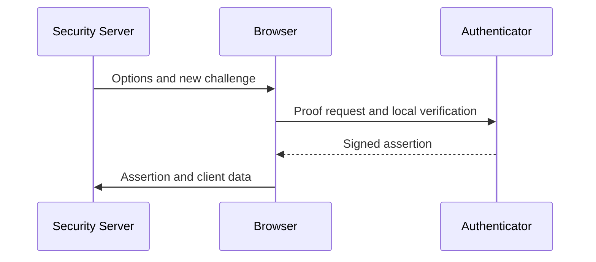

The Security Server verifies a fresh proof bound to its origin.

> [!important]
> The project policy requires **local user verification (UV)**.

---

%% footer %%

> [!info] Related
> **Key terms:** [[reference/glossary#User Verification (UV)|User Verification (UV)]]
>
> **See also:** [[06-passkeys-webauthn/registration|Passkey Registration]]

← [[06-passkeys-webauthn/registration|Passkey Registration]] · [[06-passkeys-webauthn/index|↑ Passkeys and WebAuthn]] · [[06-passkeys-webauthn/passkeys-and-mfa|Passkeys and MFA]] →
