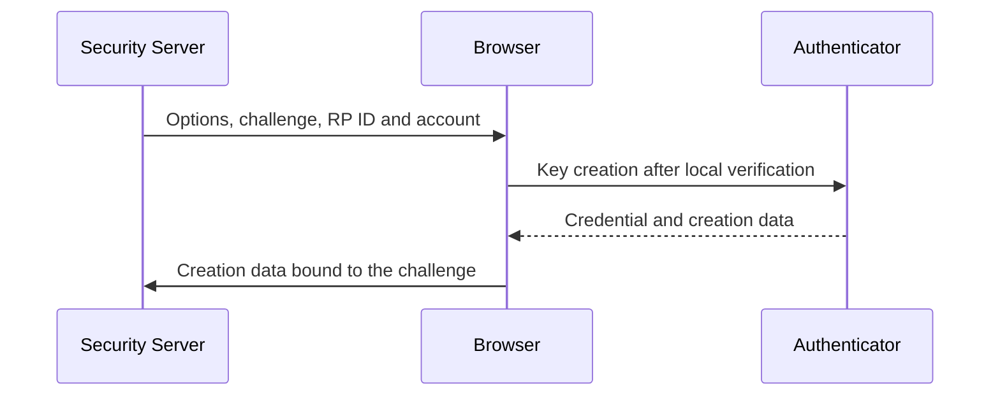

The browser and the authenticator create a key pair bound to the service.

> [!note]
> The server verifies the response and stores **the passkey identifier and its public key**.

---

%% footer %%

> [!info] Related
> **Key terms:** [[reference/glossary#WebAuthn and passkeys|WebAuthn and passkeys]]
>
> **See also:** [[06-passkeys-webauthn/authentication|Passkey Sign-In]]

← [[06-passkeys-webauthn/why-webauthn|Why WebAuthn]] · [[06-passkeys-webauthn/index|↑ Passkeys and WebAuthn]] · [[06-passkeys-webauthn/authentication|Passkey Sign-In]] →
