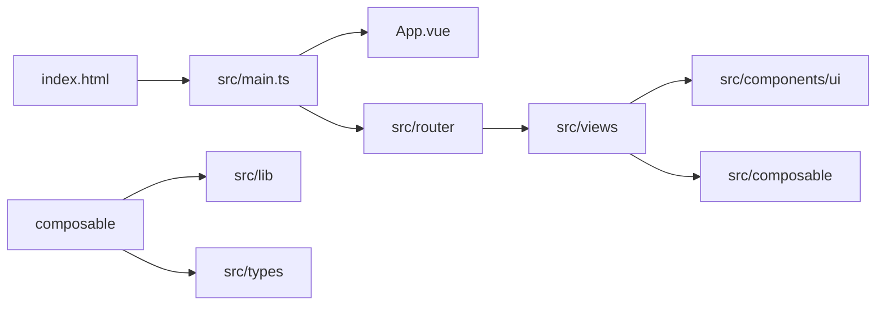
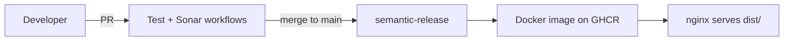

OCID is a **single-page application** (SPA). There is no back end in this repository: the app is built to static files and served by nginx. A back-end base URL can be injected at build time, see [[05-devops/environment-variables|Environment Variables]].

## Stack

| Domain | Tools |
| ------ | ----- |
| Framework | Vue 3 (`<script setup>`), Vue Router 5 |
| Language | TypeScript, SCSS (`sass-embedded`) |
| Build / dev | Vite 8 with `@vitejs/plugin-vue` and `vite-plugin-vue-devtools` |
| Tests | Cypress (component + e2e), Gherkin via `@badeball/cypress-cucumber-preprocessor` |
| Lint / format | oxlint, ESLint, Prettier, EditorConfig |
| Quality | SonarCloud, CodeRabbit |
| Delivery | Docker (Node build, nginx runtime), GHCR, semantic-release |

## Runtime flow

`main.ts` imports `main.scss`, creates the Vue app, installs the router and mounts on `#app`.

## Delivery flow

See [[05-devops/ci-cd-pipelines|CI/CD Pipelines]] and [[05-devops/release-process|Release Process]].

Related: [[02-architecture/repository-layout|Repository Layout]] · [[02-architecture/source-folders|Source Folders]]

---

%% footer %%

← [[01-getting-started/npm-scripts|npm Scripts]] · [[ocid-frontend/index|↑ Documentation home]] · [[02-architecture/repository-layout|Repository Layout]] →
