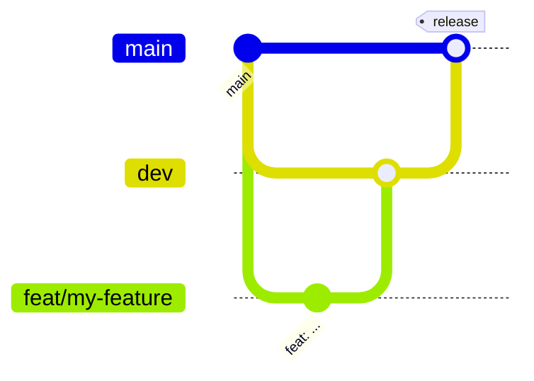

| Branch | Role |
| ------ | ---- |
| `main` | Production. A push triggers [[05-devops/release-process\|Release Process]] (and an image if a release is warranted). |
| `dev` | Integration branch. |
| `feat/*`, `fix/*` | Work branches (for example `feat/init`, `feat/test`, `feat/apiClient`). Merged by pull request. |

## Rules

- Open pull requests towards `dev` (then `dev` towards `main`).
- PRs to `main` and `dev` run the test workflow, SonarCloud and CodeRabbit ([[05-devops/ci-cd-pipelines|CI/CD Pipelines]], [[05-devops/code-quality-services|Code Quality Services]]).
- Write commit messages following [[03-development/commit-convention|Commit Convention]]: they drive versioning.
- Do not edit `CHANGELOG.md` by hand.

---

%% footer %%

> [!info] Related
> **See also:** [[05-devops/ci-cd-pipelines|CI/CD Pipelines]] · [[05-devops/release-process|Release Process]] · [[03-development/commit-convention|Commit Convention]]

← [[03-development/code-style-and-linting|Code Style and Linting]] · [[ocid-frontend/index|↑ Documentation home]] · [[03-development/commit-convention|Commit Convention]] →
