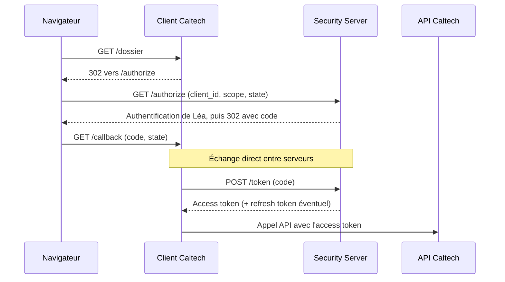

# OAuth 2.0 : le flux Authorization Code

Flux historique de référence. Il permet à Caltech d'obtenir un jeton d'accès pour l'API.

> [!warning] Limite
> Rien dans l'échange du code ne prouve qu'il est présenté par le client qui l'a demandé → [[02-pkce/pourquoi-pkce]].
