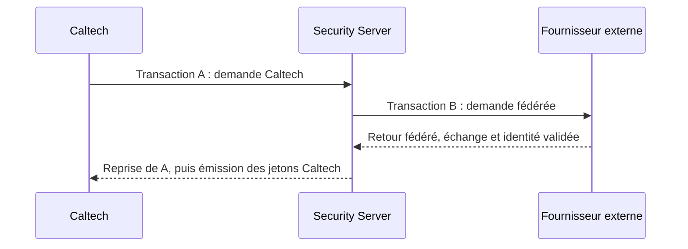

# Fédération : deux transactions OIDC

Transaction **A** pour Caltech. Transaction **B** avec le fournisseur d'identité externe.

> [!note]
> Les redirections de chaque transaction passent par le navigateur. Chaque flux a ses propres paramètres (`state`, `nonce`, PKCE…).
