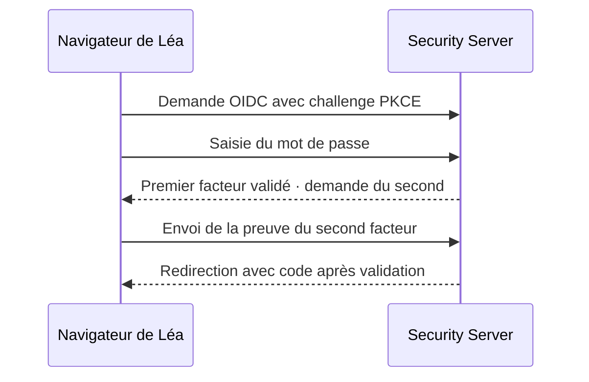

# MFA : le second facteur avant le code

Le contrôle se déroule sur le Security Server pendant l'authentification.

> [!note]
> Le navigateur revient à Caltech. L'échange à `/token` suit le flux déjà vu ([[02-pkce/flux-pkce]]).
