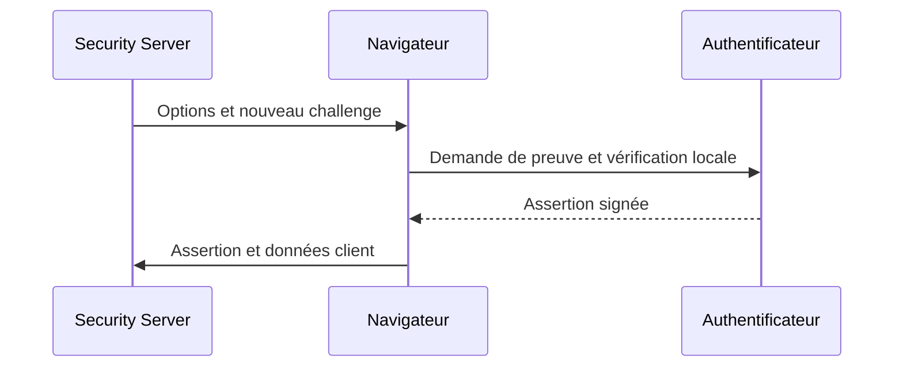

# WebAuthn : connexion par signature

Le Security Server vérifie une preuve fraîche liée à son origine.

> [!important]
> La politique du projet exige la **vérification locale de l'utilisateur (UV)**.
