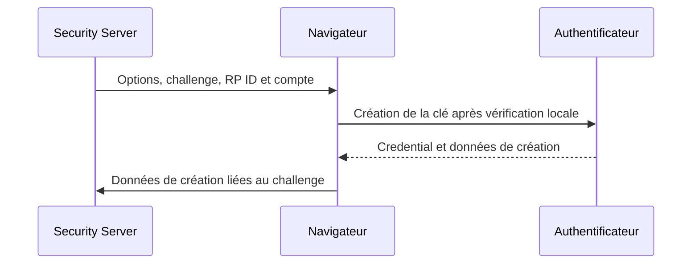

# WebAuthn : inscription d'une passkey

Le navigateur et l'authentificateur créent une paire de clés liée au service.

> [!note]
> Le serveur vérifie la réponse et conserve **l'identifiant de la passkey et sa clé publique**.
